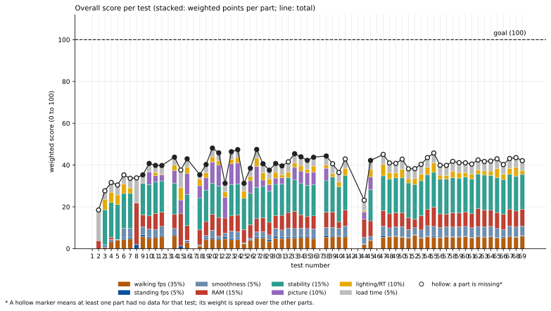

<p align="center"></p>

# M1LK

     

M1LK is an Xbox Series compatibility runtime for Windows x64, written in Rust and tuned for
**low-end NVIDIA PCs: 8 GB of VRAM and 16 GB of system RAM**. It is based on
[VIctory](https://github.com/Marvisak/VIctory) and the [DexNom fork](https://github.com/DexNom/VIctory).
It loads an Xbox Series title's x86-64 executable from an installation you supply, implements the
GDK / XGameRuntime platform services underneath it, and translates its `d3d12_xs` GPU work to desktop
Direct3D 12. M1LK targets NVIDIA only; AMD users should use other projects.

## Aim

**Make the title playable for as many people as possible on low-end NVIDIA PCs**: cards with
8 GB of VRAM or less and PCs with limited system RAM (16 GB, and less where possible).

- **Frame rate:** 30 real fps while playing first, then 60. Frame generation is welcome on top, and its
  numbers are always shown next to real fps.
- **Memory:** fit in 16 GB of system RAM with room to spare (13 GB peak or less), and in 8 GB of VRAM.
- **Settings that matter:** in-game and launcher options that really change performance (resolution
  scale, upscaling, shadows, draw distance, ray tracing and more), each with its measured cost, so
  anyone can trade picture for speed on their own machine.
- **Looks good and stays stable:** a complete, correctly lit picture and long sessions without crashes.

> [!IMPORTANT]
> **You need your own copy of the game.** M1LK contains and distributes no game files, code, assets,
> keys or download links. It only runs a title you own and installed yourself. See the
> [legal notice](#legal-notice).

The project is experimental. Expect low frame rates, rendering errors and crashes.

> [!TIP]
> **Want to help?** Message **3cvil** on Discord. Testers and contributors are welcome.
> Most of the work here is done with Claude, so **Claude API credits are what M1LK needs most**.
> Please never post an API key in an issue or comment; message me instead.

## Status

All figures come from the reference machine (RTX 4060 Laptop GPU 8 GB, i5-12500H, 16 GB RAM,
Windows 11), Series S profile, ray tracing off, with scripted keyboard and mouse play. Each one is
taken from the [test log](#test-log) below.

| | Where M1LK is today |
| --- | --- |
| **Reaches** | Menus, the intro, the first cutscene and the opening scenes in the game world. |
| **Playable** | Yes. You control the character: walk, sprint, strafe, jump, mouse look and the pause menu all respond (test 4 onward). |
| **Story progress** | The opening scenes. Tests so far play inside them. |
| **Rendering** | Complete picture in the world, but dark without ray tracing: window and outdoor light is lit; interiors and backlit people come out near black. |
| **Performance** | **About 4.5 fps walking median** in the latest runs (tests 34-35, same start point, lows 3.6 fps), 4.5 fps standing; 3.5-4.5 fps walking across tests 27-35. A walking frame takes about 215-220 ms: CPU-side preparing about 130-140 ms (of it copying title memory 72-86 ms), copy-back about 30 ms, the GPU about 20 ms. The CPU side is the limit. |
| **Stability** | No crash found in the logs of tests 14-35. Two runs ended early for other reasons: test 15 ran out of free RAM at about 10 minutes, and test 17 was stopped by the test watchdog on a first-run menu. Longest session without a crash: 20 minutes (tests 3-6). A 40-minute soak has not been run yet. |
| **Peak RAM** | 15.8-17.8 GB (goal: 13 GB). Free RAM gets close to zero while walking. |
| **Ray tracing** | BVH builder and wave32 fixes are merged; not measured in game yet. |

### Milestones

- [x] Boot to the menus, the intro and the first cutscene.
- [x] Load into the game world and control the character, with the pause menu (test 4).
- [x] 20 minutes without a crash (test 3).
- [x] Series S profile runs with a full picture and HUD (test 10).
- [x] Paging stalls removed from the median frame: 0.5 fps to 2.8 fps, then about 4 fps (tests 3-14).
- [ ] Peak RAM 13 GB or less.
- [ ] 40-minute soak without a crash.
- [ ] Ray tracing measured in game on NVIDIA.
- [ ] 30 real fps (frame generation numbers are always reported next to real fps).
- [ ] 60 real fps on the reference machine.
- [ ] Performance settings with measured costs, documented for low-end cards.

## Test log

Charts for every test (fps, frame-time split, draws, RAM, GPU clock) and an overall weighted score per test are in [docs/tests](docs/tests/README.md).



Every test run is logged here automatically, with its settings and a picture check.

<details>
<summary>All test runs (newest at the bottom)</summary>

| # | Date | Build | Settings | Result |
| --- | --- | --- | --- | --- |
| 1 | 2026-11-26 | memory fix 1 | Series X, `--no-rt`, `M1LK_TEXTURE_MIP_DROP=1` | Peak 17.2 GB, 5.9 GB of VRAM. Watchdog after 5 min 46 s with heavy paging. |
| 2 | 2026-11-26 | RAM branch | Series X, `--no-rt`, window budget 1 GB, RAM trim 3 GB | Got further (10 min 19 s) but peaked at 20.0 GB, with 7.3 GB of VRAM. Duplicated texture copies (about 5 GB) and a window budget that did not hold were found. |
| 3 | 2026-11-26 | RAM branch + pressure sweeps | Series X, `--no-rt`, mip drop 2 (textures of 512 px and up), window budget 1 GB, RAM trim 3 GB | **20 min with no crash** (the full test). Menus at 30 fps; in game a median of 0.5 fps, with frames spending 0.9 s (median) to 9.6 s (worst quarter) waiting on paging. Peak 21.6 GB, 6.8 GB of VRAM. The largest memory buckets were made shared buffers (8.1 GB), title window copies (5.2 GB) and host textures (5.0 GB). |
| 4 | 2026-11-26 | merged build (all of today's work) | Series X, `--no-rt`, mip drop 2, window budget 1 GB, windows in Resizable BAR card memory, constants on the card, 2 MB sections; scripted keyboard and mouse play | **20 min with no crash, 5.6x faster:** median **2.8 fps** (was 0.5), worst quarter 1.1 fps (was 0.08). Paging stalls went from 80% of the median frame to none. Walking, sprinting, strafing, jumping, mouse look and the pause menu all respond. The top costs now are copy-back (170 ms) and buffer copies (100 ms). Peak commit 20.0 GB, working set 5.9 GB, 7.7 GB of VRAM. |
| 5 | 2026-11-26 | + skip write-combined copy-back, + window tails | as above, plus `M1LK_SKIP_WC_BACK=1` and `M1LK_WINDOW_TAILS=1` | 20 min, no crash. **Median 3.6 fps** (was 2.8): copy-back fell from 170 ms to 28 ms a frame. The worst quarter got worse (0.7 fps, was 1.1) because window tails grew window memory (4.6 GB, was 3.7) and paging came back. Tails are dropped; copy-back skip is kept. |
| 6 | 2026-11-26 | new build: hair skip, UI mips kept, quiet-copy skip, sliced heap rescan, texture read-backs on a thread, wave32 groupshared guard | as above (copy-back skip on) | 20 min, no crash. **Worst quarter 3.0 fps** (was 0.7), so the bad frames are almost gone; median 3.3 fps (3.6 before, in a different, busier scene). No paging stalls at all. About 3,400 unchanged copies a frame are now skipped, and copies fell to 71 ms. Hair renders cleanly (strands are left out for now). |
| 7 | 2026-11-26 | + wide refresh | as above, plus `M1LK_WIDE_REFRESH=1`, 15 min with play | Median 3.5 fps (3.3 without), within noise, so it stays optional. The ~1,400 draws a frame shown as dropped are all ray-tracing stages (off in `--no-rt`) and left-out hair strands, so nothing is missing by mistake. |
| 8 | 2026-11-26 | Series S fix | Series S, `--no-rt`, 8 min | **No device removal** (it used to happen at about 2.5 min). The shared-exponent target uses its stand-in format, and the run reached 7 min 48 s at 5.4 fps while the scene was still loading. |
| 9 | 2026-11-26 | Series S fix | Series S, `--no-rt`, 15 min with play | Stable, **median 5.3 fps, peak 17.3 GB**, but the picture was black in game and the menus were missing. |
| 10 | 2026-11-26 | Series S picture fix | Series S, `--no-rt`, 15 min with play | **Picture and pause menu show.** Median 4.5 fps, peak 17.1 GB, no crash. The scene is as dark as on Series X (lighting without ray tracing). |
| 11 | 2026-11-27 | + ambient light stand-in, title's own upscaler | Series S, `--no-rt`, `M1LK_UPSCALER=6`, 15 min with play | Median 4.6 fps, peak 16.4 GB, no crash. Rooms are still very dark. Found later: floating white blocks and orange speckles in one outdoor scene (Series S only; being fixed). |
| 12 | 2026-11-27 | same build, repeat | as above | Standing 3.9 fps, **walking 5.1 fps** (low 4.3), peak 16.9 GB, no crash. Same white blocks and speckles. Free RAM fell to 45 MB during the run. |
| 13 | 2026-11-27 | DLSS fix, copy changes, fork fixes | Series S | Not valid: these test builds were made without the scripted-input feature, so they waited at a menu. Being re-run with the right build. |
| 14 | 2026-11-27 | fork fixes (shader NaN, helper lanes, cache, compute waits) + DLSS fix | series-s, --no-rt | standing/all median 4.5 fps (91 samples), peak 5942 draws/frame; WALKING median 5.4 fps, low 3.6 (32 samples). Picture: clean in the window scene, no white blocks; small pale smear at the left edge. |
| 15 | 2026-11-27 | fork fixes, shader loop limit 1024 (was 32) | series-s, --no-rt, M1LK_SHADER_LOOP_LIMIT=1024 | standing/all median 3.3 fps (57 samples), peak 7146 draws/frame; no walking samples; free RAM fell to 0.1 GB and the run stopped at about 10 min. Picture: white specks and a blocky sky in the window view (not seen with limit 32). Result: worse, keep 32. |
| 16 | 2026-11-27 | fork fixes, title memory kept in place (M1LK_INPLACE=1) | series-s, --no-rt, M1LK_INPLACE=1 | standing/all median 3.5 fps (126 samples), peak 10636 draws/frame; WALKING median 2.6 fps, low 0.2 (42 samples). Picture: clean, no blocks or specks (flagged shots were ceiling lights); the character's head now draws; room very dark. Not comparable to #14: this run reached a heavier scene (10.6k vs 5.9k draws/frame). Same-session repeat queued. |
| 17 | 2026-11-27 | parallel texture checks (M1LK_PARALLEL_REFRESH=1) | series-s, --no-rt, M1LK_PARALLEL_REFRESH=1 | No result: stopped by the test watchdog after about 9 minutes (not a crash). The test install had lost its saved settings, so the run sat on a first-run menu screen and never reached the world. Rerun queued with the settings restored. |
| 18 | 2026-11-27 | parallel texture checks (M1LK_PARALLEL_REFRESH=1), rerun | series-s, --no-rt, M1LK_PARALLEL_REFRESH=1 | Inconclusive: the option did not take effect in this build (it covers only one of the texture paths the title uses), and the run started with less free memory and reached a smaller scene, so its frame rates are not comparable. Prologue/standing median 0.8 fps (35 samples), walking median 1.6 fps, low 0.1 (30 samples), peak 6729 draws/frame, peak RAM 16.6 GB. In the world, buffer copies took a median 172 ms a frame against 18 ms for texture checks. Picture: mostly intro and cutscene footage; shaded surfaces and backlit people come out near black (the ray-tracing-off fill light is too weak), bloom blows out in one backlit shot. |
| 19 | 2026-11-27 | fill light 0.6 (M1LK_AMBIENT=0.6; default 0.3) | series-s, --no-rt, M1LK_AMBIENT=0.6 | Prologue/standing median 4.1 fps (81 samples), walking median 3.8 fps, low 0.9 (43 samples), peak 12789 draws/frame, peak RAM 16.9 GB. The fill light is a picture setting: fps and memory are within run-to-run noise and the runs reached different scenes, so no performance claim is made. Picture: slightly brighter (one dark bunk room clearly better), no washed-out shadows or glaze; still far too dark overall, with backlit people as silhouettes and late interiors near black, so the fill level is not the main cause. |
| 20 | 2026-11-27 | fill light follows the sky (M1LK_AMBIENT=sky): picture brightness check | series-s, --no-rt, M1LK_AMBIENT=sky | Prologue/standing median 4.0 fps (89 samples), walking median 3.9 fps, low 2.8 (46 samples), peak 9518 draws/frame, peak RAM 16.5 GB. The fill light is a picture setting: fps and memory are within run-to-run noise (all runs RAM-starved with heavy paging, different scenes), so no performance claim is made. Picture: darker than both the constant 0.3 and 0.6 fill (cell/bunk mean brightness about 40 vs 47 and 54), no new artifacts; the flagged shots were ceiling lights and grass grain. Not adopted. A likely bigger cause of the darkness (a diagnostics loop cap of 32 used in all recent tests) is being tested next. |
| 21 | 2026-11-27 | shader loop cap 1024 instead of 32 (dark picture fix test) | series-s, --no-rt, M1LK_SHADER_LOOP_LIMIT=1024 | Prologue/standing median 4.4 fps (70 samples), walking median 3.8 fps, low 0.7 (44 samples), peak 7725 draws/frame, peak RAM 15.8 GB. No measurable fps or RAM difference from the 32 cap in this single noisy test (different scene and free RAM; a build ran during the last minute, in the end-of-run fade); frame time is about 250 ms, of which the GPU is only 14-18 ms and CPU-side preparing about 140 ms. Picture: no brighter than at 32 (rooms still dark, characters still silhouettes), no sparks; flagged shots were ceiling lights. This conflicts with an earlier 1024 run that showed a lit character in one scene, so the loop cap is unlikely to be the main cause but is not ruled out; a back-to-back repeat is parked. Next for lighting: a basic ray-tracing run once fps is up. |
| 22 | 2026-11-27 | in-place constants heap (M1LK_INPLACE_CONSTANTS=1, port constants off) | series-s, --no-rt, M1LK_INPLACE_CONSTANTS=1, M1LK_PORT_CONSTANTS=- | Prologue/standing median 4.9 fps (87 samples), walking median 4.2 fps, low 2.0 (30 samples), peak 6562 draws/frame, peak RAM 16.7 GB. Not a measured gain: the in-place constants path opened 0 regions for the whole run (the switch was on but never engaged), buffer copies did not drop, and the run used a different build and reached a lighter scene; the fps difference is within run-to-run noise. Hard faults were much lower than in recent runs (about 300/s vs thousands), cause not yet known. Picture: no broken constants symptoms (colours, shapes, textures normal); the black screen from about 766 s that stopped the run looks like the end-of-run fade seen in earlier runs (not confirmed; the rerun, test 24, did not go black, but one run does not settle it). Root cause of the 0 regions is being investigated. |
| 23 | 2026-11-27 | write-watch asked once per step (M1LK_ASK_REASK=1) | series-s, --no-rt, M1LK_ASK_REASK=1, M1LK_SUBMIT_PROF=1 | Prologue/standing median 3.9 fps (67 samples), walking median 3.6 fps, low 2.6 (45 samples), peak 8600 draws/frame, peak RAM about 16.6-17.0 GB. No measurable change: the once-per-step ask path reported 0.00 ms all run (it may not have engaged), and the walking median is within the about 0.5 fps run-to-run noise; this build is on an older base and reached the world later, so it is not directly comparable. The submit profile shows sweep about 39 ms and settle about 20 ms per frame, but does not account for the 84 ms of buffer copies, which still needs measuring. Picture: no stale-data symptoms (no frozen or wrong textures, no flicker); flagged shots were ceiling lights in the known dark rooms; a white stretch after loading matches earlier runs. |
| 24 | 2026-11-27 | in-place constants rerun after the arrange fix | series-s, --no-rt, M1LK_INPLACE_CONSTANTS=1, M1LK_PORT_CONSTANTS=- | standing/all median 3.6 fps (127 samples), peak 10003 draws/frame; WALKING median 3.8 fps, low 2.4 (46 samples); peak 16.3 GB. Not a gain: the switch was on but still opened no memory regions (the heap is split across sections), so this is the baseline path. Ran on battery power with heavy paging, so ~3.6 fps should not be compared with the plugged-in runs (~4 to 5 fps). Picture: no render artifacts in the flagged shots (they were ceiling lights and a fade); dark without RT, near-black around 735 to 800 s (unlit room). |
| 25 | 2026-11-27 | GPU detile + in-place constants (fps) | series-s, --no-rt, M1LK_INPLACE_CONSTANTS=1, M1LK_PORT_CONSTANTS=-, M1LK_GPU_DETILE=1 | standing/all median 1.3 fps (44 samples), peak 8424 draws/frame; WALKING median 2.9 fps, low 0 (7 samples); peak 17.5 GB. Not adopted. GPU detiling ran without errors but did not lower texture time, and some textures came out scrambled (a dotted grid over the sky and walls), so one tiling layout is unpacked wrongly. The machine also froze for about 7 minutes with free RAM at the floor, and the run was mostly on battery, so these fps numbers are not comparable. In-place constants was still inactive (0 regions). |
| 26 | 2026-11-27 | plugged-in baseline with the submit profiler (the copy profiler was not in this build) | series-s, --no-rt, M1LK_COPY_PROF=1 (inactive), M1LK_SUBMIT_PROF=1 | standing/all median 3 fps (86 samples), peak 9105 draws/frame; WALKING median 3.5 fps, low 0.4 (44 samples); peak 17.2 GB. Plugged in, but it started with less free RAM, paged about 4x harder than test 24 and stalled for about 4 minutes, so it is not a clean baseline. Plugged-in vs battery runs show no fps difference beyond run-to-run noise (about 0.5-1 fps); free RAM at launch predicts results better. Submit profile: memory sweep ~48 ms per frame is the largest submit-side cost. Picture: complete and sharp, no scrambled textures; faint 1-pixel dither in very dark areas. |
| 27 | 2026-11-27 | batch the per-record indirect clamps (about 2,700 extra GPU passes a frame now) | series-s, --no-rt, M1LK_INDIRECT_WINDOW=1 | standing/all median 4.3 fps (136 samples), peak 8263 draws/frame; WALKING median 4.3 fps, low 2 (47 samples); peak 17.0 GB. The batching engaged (re-bounded indirect commands per frame fell from about 3,700 to about 1,000, with about 2,000 reused), but the fps gain over test 26 is not attributed to it: this run started with 2 GB more free RAM, paged about half as hard and had no profiler running, and the result is within run-to-run noise of earlier unprofiled runs (3.6-4.8 fps). A back-to-back on/off pair is queued. Picture: same scene as before with every object present and no new artifacts; still dark, noisy and flat-lit without ray tracing. |
| 28 | 2026-11-27 | copy time breakdown (profiling run, no behavior change) | series-s, --no-rt, M1LK_COPY_PROF=1, M1LK_SUBMIT_PROF=1 | standing/all median 4.4 fps (137 samples), peak 6063 draws/frame; WALKING median 4.3 fps, low 2.1 (46 samples); peak 16.9 GB. Copies took a median 84 ms a frame. The largest part is the update step (63 ms): its stale-range walk alone took about 20 ms while scanning about 7.6 GB of ranges to copy only about 67 MB, and the copying itself took about 19 ms. On the submit side, the memory sweep took about 27 ms a frame. This run is used for the breakdown only. Its fps is within run-to-run noise of test 27 and is not compared, because the indirect window was off, the scene differed and both runs paged heavily. Picture (corrected after a closer check): small faint grey-blue blocks sit on the yard seen through the window in about 12 shots; they were first misread as lights. Still dark and noisy without ray tracing. |
| 29 | 2026-11-27 | in-place host reads instead of a kernel call per copy (ported) | series-s, --no-rt, M1LK_COPY_PLAIN=1, M1LK_SHORT_REMAP_LOCK=1, M1LK_COPY_PROF=1, M1LK_SUBMIT_PROF=1 | standing/all median 3.8 fps (135 samples), peak 9930 draws/frame; WALKING median 3 fps, low 1.4 (46 samples); peak 17.6 GB. The in-place reads engaged with no faults or fallbacks and cut the copy sub-steps by roughly a quarter (median over about 670 profile lines). No fps gain is claimed: standing fps (median 4.5) is level with test 28, the walking drop is more likely memory pressure (both runs ran out of free RAM) and scene than this change, and this run used a different build and an extra memory setting. A same-build on/off pair is needed. Picture: the yard blocks from test 28 are present in about 12 shots and much brighter (white and light blue); a root-cause check is under way. Still dark without ray tracing. |
| 30 | 2026-11-27 | CGBJ low-commit back-off: defer texture uploads and cap look-ahead staging when RAM is short | series-s, --no-rt, M1LK_WAVE_WHY=1 | standing/all median 4.7 fps (137 samples), peak 6513 draws/frame; WALKING median 4.3 fps, low 3.4 (46 samples). Picture check pending. Walking fps matches test 28 (mean 4.4 in both), and standing is slightly higher (mean 4.4 against 3.9). It is not credited to the low-commit change: the builds differ, test 30 had no profilers running, and the better walking low (3.4 fps) rests on only 2-3 samples. A repeat run is queued. Picture: the yard blocks seen through the window are still present (12 shots, fewer but brighter, with faint trails); near-black frames at about 730-800 s are the dark cell without ray tracing, the same as test 29; the scene is complete. |
| 31 | 2026-11-27 | yard-block check: exact wave64 split instead of the per-half approximation (if the blocks go, that is the cause) | series-s, --no-rt, M1LK_WAVE_LOCAL=idiom, M1LK_WAVE_WHY=1 | standing/all median 4.2 fps (132 samples), peak 6776 draws/frame; WALKING median 4.1 fps, low 2.8 (46 samples); peak RAM 17.1 GB. Picture: yard blocks not gone (one block seen in the shots checked; no count comparison with test 30 possible, its matching shot was too dark), so the wave64 split does not fully fix them; dither holes on the character edge. Caveat: build and setting changed together vs test 30, and the 0.5 fps gap is inside run-to-run noise; both runs paged heavily (about 60 MB free at the low point). |
| 32 | 2026-11-27 | check: start from the cell autosave (pair runs share this start point if it lands in a playable scene) | series-s, --no-rt | standing/all median 3.8 fps (95 samples), peak 6656 draws/frame; WALKING median 3.8 fps, low 3 (58 samples). Picture check pending. |
| 33 | 2026-11-27 | copy-plain + remap lock ON (its off pair was dropped; round 1 retests it) | series-s, --no-rt, M1LK_COPY_PLAIN=1, M1LK_SHORT_REMAP_LOCK=1, M1LK_COPY_PROF=1, M1LK_SUBMIT_PROF=1 | standing/all median 4.2 fps (92 samples), peak 8678 draws/frame; WALKING median 4.3 fps, low 3.5 (57 samples). Copy time per walking frame 71 ms vs 96 ms in test 32 (same save), but the exe differs, there is no off run and local builds ran early in both, so the cause is not proven; the fps gap is inside the noise. Picture: no new artifacts (no garbled or stretched textures, no black frames); a few small blue dots at the window edge, but the yard view differs from test 32, so no block comparison; per-pixel dither in dark areas of brightened shots. |
| 34 | 2026-11-27 | round 1 (combo a56b129): baseline A, every switch off | series-s, --no-rt, M1LK_COPY_PROF=1, M1LK_SUBMIT_PROF=1 | standing/all median 4.5 fps (91 samples), peak 6877 draws/frame; WALKING median 4.5 fps, low 3.6 (54 samples). Peak RAM 17.0 GB. Reference for round 1: per walking frame, copies take 86 ms (middle half of frames 81-96 ms), preparing 140 ms (132-148), copy-back 32 ms (27-38); walking draws a median 4418 a frame, the same scene as tests 32 and 33. A switch has to bring its own stage clearly below that spread to count, and baseline B at the end of the round measures the run-to-run gap. Picture: no new artifacts named against a matching view (no shot looks at the yard, so no block count); a dark floating box with coloured edges in one rooftop shot, origin unknown; dither in dark areas and on the characters; no black frames. |
| 35 | 2026-11-27 | round 1: ONE change on vs baseline: host copies read title memory in place | series-s, --no-rt, M1LK_COPY_PLAIN=1, M1LK_COPY_PROF=1, M1LK_SUBMIT_PROF=1 | standing/all median 4.5 fps (94 samples), peak 7149 draws/frame; WALKING median 4.5 fps, low 3.6 (57 samples). Against baseline A (test 34, same exe and save): copies per walking frame 72 ms (middle half 65-76) vs 86 ms (81-96), preparing 130 vs 140 ms, but the whole frame only 216 vs 220 ms and walking fps the same (4.6, low 3.6); peak RAM 17.8 vs 17.4 GB with less free RAM at the start. Provisional: the copy step is faster; the round-end baseline B decides. Picture: no new artifacts from the copy change (no garbled, stale or stretched textures, no missing objects); the dark late frames and dither in dark areas are as in the baseline. |
| 36 | 2026-11-27 | round 1: ONE change on vs baseline: remap lock released right after the texture copy | series-s, --no-rt, M1LK_SHORT_REMAP_LOCK=1, M1LK_COPY_PROF=1, M1LK_SUBMIT_PROF=1 | standing/all median 4.1 fps (94 samples), peak 7019 draws/frame; WALKING median 4.1 fps, low 3.4 (58 samples). peak 17.1 GB. Walking frame 246 ms vs 218 ms baseline (test 34): preparing 154 vs 140 ms, copies 93 vs 86 ms; the lock wait it targets went only 17 to 15 ms. No gain, possibly a small loss, but within run-to-run noise until the second baseline runs. Same draws, GPU clock and free RAM as the baseline; more hard page faults while walking. Picture: BAD. Known yard-window blocks still visible, dither in dark areas unchanged, and probably one NEW artifact: a ragged, blotchy edge around the character's head and the wall beside it that the baseline run does not show in the same shot (one comparable pair only). |
| 37 | 2026-11-27 | round 1: ONE change on vs baseline: wider write-watch asks, one scan per window | series-s, --no-rt, M1LK_WATCH_SCAN=1, M1LK_COPY_PROF=1, M1LK_SUBMIT_PROF=1 | never reached the world (draws/frame <= 200); peak 3.8 GB. Startup hang: no frame was drawn in 11 minutes, and the count of emulated CPU-wait instructions reached 134 million, against about 4 million before the world loads in tests 34-36. That suggests a thread waiting for something that never came, but the cause is not confirmed yet. One run only, but a hang at startup rules this switch out until the cause is found. No picture to check. |
| 38 | 2026-11-27 | round 1: ONE change on vs baseline: texture upload back-off under low commit | series-s, --no-rt, M1LK_LOWCOMMIT_BACKOFF=1, M1LK_COPY_PROF=1, M1LK_SUBMIT_PROF=1 | standing/all median 4.7 fps (94 samples), peak 6512 draws/frame; WALKING median 4.7 fps, low 3.7 (58 samples). peak 16.6 GB. Walking frame 213 ms vs 218 ms baseline (test 34), copy-back 27 vs 32 ms, peak RAM 0.4 GB lower, fewer hard page faults; all within run-to-run noise, so unconfirmed (repeat queued). It started with less free RAM (6.1 vs 7.4 GB), which should have hurt it. Picture: BAD. Yard-window blocks not seen, but more frames drop to near-black and dark areas show stronger per-pixel dither than the baseline; exposure needs fixing before this build is judged on picture. |
| 39 | 2026-11-27 | round 1: ONE change on vs baseline: constants heap in place | series-s, --no-rt, M1LK_INPLACE_CONSTANTS=1, M1LK_PORT_CONSTANTS=-, M1LK_COPY_PROF=1, M1LK_SUBMIT_PROF=1 | standing/all median 4.4 fps (92 samples), peak 6936 draws/frame; WALKING median 4.4 fps, low 3.3 (55 samples). Picture: no clearly new artifact against test 34 (one small orange floor blob at 493 s is unconfirmed). Walking frame 224 ms against 218 ms in test 34; preparing (146 against 140 ms) and copies (89 against 86 ms) did not drop. Within run-to-run noise, no gain: not merged. Heavy paging (3,000-6,000 hard faults/s) may hide a small saving. |
| 40 | 2026-11-27 | round 1: ONE change on vs baseline: texture detiling on the card | series-s, --no-rt, M1LK_GPU_DETILE=1, M1LK_COPY_PROF=1, M1LK_SUBMIT_PROF=1 | standing/all median 4.2 fps (86 samples), peak 12404 draws/frame; WALKING median 4.3 fps, low 3 (52 samples). Picture: no new artifact against test 34 (no texture corruption or doubled geometry). Detiling ran on the card, but walking frame was 232 ms against 222 ms in test 34 (within noise) and the texture stage did not drop; the CPU detile cost was only about 0.5 ms/frame. The 12404 draws/frame peak is one 6.7 s hitch while standing, not a doubling. Private memory was about 1.7 GB higher (one run, cause not confirmed). Not merged, parked. |
| 41 | 2026-11-27 | CPU sampling profiler (where the ~215 ms frame goes, per thread and function) | series-s, --no-rt, M1LK_SAMPLE_PROF=1 | standing/all median 4.3 fps (85 samples), peak 6639 draws/frame; WALKING median 4.4 fps, low 3.5 (49 samples). Picture check pending. |
| 42 | 2026-11-27 | VIctory-NVIDIA snapshot (test/vnv-base), frame generation off, same save: compare against r1-base-b just before it | series-s, --no-rt, M1LK_LAUNCH_STYLE=run, M1LK_FPS_LINE=1, M1LK_PROF=1, M1LK_FRAMEGEN=-, M1LK_MENU_FRAMEGEN=- | INVALID: the build sat on its own first-run terms screen (different save folder), and the fps shown were read from an older run's log. Fixed in the test script. |
| 43 | 2026-11-27 | VIctory-NVIDIA snapshot (test/vnv-base) rerun with a log file, frame generation off, same save: compare against r1-base-b right after | series-s, --no-rt, M1LK_LAUNCH_STYLE=run, M1LK_FPS_LINE=1, M1LK_PROF=1, M1LK_FRAMEGEN=-, M1LK_MENU_FRAMEGEN=- | INVALID: same terms-screen problem; fps again from an older run's log. Fixed in the test script. |
| 44 | 2026-11-27 | VIctory-NVIDIA snapshot, now with our save and settings copied into its own save folder (earlier tries sat on the first-run terms screen), log file on, frame generation off | series-s, --no-rt, M1LK_LAUNCH_STYLE=run, M1LK_FPS_LINE=1, M1LK_PROF=1, M1LK_FRAMEGEN=-, M1LK_MENU_FRAMEGEN=- | Cold first run, not like-for-like: about 500 s were spent building pipelines (1295 to 0 still being made), so the 1.6 walking figure is mostly that phase. After that it ran about 4.2-5 fps (our range) at roughly 2,300 draws/frame against our ~4,400. Peak private memory 16.6-17.0 GB. Picture: brighter, more complete room lighting than ours, but heavy speckle/dither noise, smeared hair and floating orange rectangles (different scene from ours, so only a rough comparison). Warm rerun queued. |
| 45 | 2026-11-27 | VIctory-reloaded snapshot 9941051 (its own NVIDIA defaults): whole-build comparison vs M1LK on our laptop, same save | series-s, --no-rt, M1LK_LAUNCH_STYLE=run, M1LK_LOG_STDERR=1, VICTORY_LOG=info, M1LK_FPS_LINE=1, M1LK_PROF=1 | standing/all median 1.5 fps (83 samples), peak 6263 draws/frame; WALKING median 3.3 fps, low 1.3 (59 samples). Cold run: shaders and pipelines were still being built for about the first 9 minutes, so these numbers mostly measure that, not play. Picture: dark walls and blocky tile artifacts in places. Inconclusive as a comparison. |
| 46 | 2026-11-27 | VIctory-reloaded snapshot, second (warm) run: shaders/pipelines already built by rel-base, the fair fps comparison | series-s, --no-rt, M1LK_LAUNCH_STYLE=run, M1LK_LOG_STDERR=1, VICTORY_LOG=info, M1LK_FPS_LINE=1, M1LK_PROF=1 | never reached the world (draws/frame <= 200). Crashed in the title code (null write) at about 107 s, right after free RAM fell to 0.1 GB while loading. That build ran this 16 GB laptop out of memory; not an M1LK bug. No comparison possible. |
| 47 | 2026-11-27 | round 1 baseline B repeat (current main build, profilers on) | series-s, --no-rt, M1LK_COPY_PROF=1, M1LK_SUBMIT_PROF=1 | standing/all median 4.2 fps (93 samples), peak 12361 draws/frame; WALKING median 4.2 fps, low 3.6 (56 samples); peak 16.9 GB. Picture: unusable. The screenshots froze on a still title image from about 122 s while the log shows the game kept rendering (4 fps lines to the end), so this was a screenshot-capture fault, not a game freeze. Use the fps only. |
| 48 | 2026-11-27 | pair for r12-homogenize-on (same build, M1LK_INPLACE off) | series-s, --no-rt, M1LK_COPY_PROF=1, M1LK_SUBMIT_PROF=1 | standing/all median 3.7 fps (65 samples), peak 6721 draws/frame; WALKING median 4 fps, low 3.3 (50 samples). Picture check pending. |
| 49 | 2026-11-27 | M1LK ZCM diagnosis: logs why the constants-heap arrange step exits silently (grep M1LK ZCM:) | series-s, --no-rt, M1LK_INPLACE_CONSTANTS=1, M1LK_PORT_CONSTANTS=-, M1LK_COPY_PROF=1, M1LK_SUBMIT_PROF=1 | standing/all median 4.2 fps (65 samples), peak 7140 draws/frame; WALKING median 4.3 fps, low 3.5 (50 samples). Picture check pending. |
| 50 | 2026-11-27 | ASK_REASK control (same build, switch off): biggest estimated CPU lever ~45ms write-watch | series-s, --no-rt, M1LK_COPY_PROF=1, M1LK_SUBMIT_PROF=1 | standing/all median 3.9 fps (65 samples), peak 6399 draws/frame; WALKING median 4.1 fps, low 3.5 (50 samples). Picture check pending. |
| 51 | 2026-11-27 | ASK_REASK on: stop re-asking GetWriteWatch each flush | series-s, --no-rt, M1LK_ASK_REASK=1, M1LK_COPY_PROF=1, M1LK_SUBMIT_PROF=1 | standing/all median 4.1 fps (65 samples), peak 6317 draws/frame; WALKING median 4.3 fps, low 3.7 (51 samples). Picture check pending. |
| 52 | 2026-11-27 | M1LK ZCM fix 650f79b8: the 32-bit graphics heap's reservation recorded for arranging, so the constants heap can be one run of one section | series-s, --no-rt, M1LK_INPLACE_CONSTANTS=1, M1LK_PORT_CONSTANTS=-, M1LK_COPY_PROF=1, M1LK_SUBMIT_PROF=1 | standing/all median 4.2 fps (66 samples), peak 6521 draws/frame; WALKING median 4.5 fps, low 3.7 (50 samples). Picture check pending. |
| 53 | 2026-11-27 | M1LK ZCM combo build (round12 + heap fix 82ffb0bd), both zero-copy switches OFF: control | series-s, --no-rt, M1LK_PORT_CONSTANTS=-, M1LK_COPY_PROF=1, M1LK_SUBMIT_PROF=1 | standing/all median 3.8 fps (65 samples), peak 6963 draws/frame; WALKING median 3.9 fps, low 3.3 (50 samples). Picture check pending. |
| 54 | 2026-11-27 | M1LK ZCM combo build, both zero-copy paths ON: constants heap (174 MB) + title windows read in place | series-s, --no-rt, M1LK_INPLACE_CONSTANTS=1, M1LK_INPLACE=1, M1LK_PORT_CONSTANTS=-, M1LK_COPY_PROF=1, M1LK_SUBMIT_PROF=1 | standing/all median 4 fps (64 samples), peak 6561 draws/frame; WALKING median 4.3 fps, low 3.6 (50 samples). Picture check pending. |
| 55 | 2026-11-27 | M1LK ZCM Tell (df400589): combo-on plus telling placed textures what the card wrote in place | series-s, --no-rt, M1LK_INPLACE_CONSTANTS=1, M1LK_INPLACE=1, M1LK_PORT_CONSTANTS=-, M1LK_ZCM_TELL=1, M1LK_COPY_PROF=1, M1LK_SUBMIT_PROF=1 | standing/all median 4 fps (65 samples), peak 7118 draws/frame; WALKING median 4.3 fps, low 3.5 (50 samples). Picture check pending. |
| 56 | 2026-11-27 | M1LK ZCM combo-on without the 2 MB section split: does the section-view path (443+ regions turned down 'not one run of a section') place memory once allocations stay whole? watch peak RAM | series-s, --no-rt, M1LK_INPLACE_CONSTANTS=1, M1LK_INPLACE=1, M1LK_PORT_CONSTANTS=-, M1LK_SECTION_MB=-, M1LK_COPY_PROF=1, M1LK_SUBMIT_PROF=1 | standing/all median 4.2 fps (64 samples), peak 9952 draws/frame; WALKING median 4.3 fps, low 3.7 (49 samples). Picture check pending. |
| 57 | 2026-11-27 | frame-overlap quick test, existing switches only: combo-on plus more room for submissions in the air (fewer forced settles) | series-s, --no-rt, M1LK_INPLACE_CONSTANTS=1, M1LK_INPLACE=1, M1LK_PORT_CONSTANTS=-, M1LK_SETTLE_ROOM=1, M1LK_LATE_WAIT_LISTS=512, M1LK_COPY_PROF=1, M1LK_SUBMIT_PROF=1 | standing/all median 3.7 fps (65 samples), peak 6412 draws/frame; WALKING median 3.9 fps, low 3 (50 samples). Picture check pending. |
| 58 | 2026-11-27 | M1LK Watch Skip pair, OFF half (same exe as ws-on | series-s, --no-rt, M1LK_INPLACE_CONSTANTS=1, M1LK_INPLACE=1, M1LK_PORT_CONSTANTS=-, M1LK_COPY_PROF=1, M1LK_SUBMIT_PROF=1 | standing/all median 3.9 fps (64 samples), peak 6943 draws/frame; WALKING median 4.2 fps, low 2.5 (50 samples). Picture check pending. |
| 59 | 2026-11-27 | M1LK Watch Skip ON: skip ~4150 failed write-watch asks/frame on view memory | series-s, --no-rt, M1LK_INPLACE_CONSTANTS=1, M1LK_INPLACE=1, M1LK_PORT_CONSTANTS=-, M1LK_COPY_PROF=1, M1LK_SUBMIT_PROF=1, M1LK_WATCH_SKIP=1 | standing/all median 4.4 fps (65 samples), peak 11629 draws/frame; WALKING median 4.5 fps, low 3.8 (50 samples). Picture check pending. |
| 60 | 2026-11-27 | M1LK Strain: let 4 non-hair programs (cull masks, LOD blends, decal cuts, fire volumes) run | series-s, --no-rt, M1LK_INPLACE_CONSTANTS=1, M1LK_INPLACE=1, M1LK_PORT_CONSTANTS=-, M1LK_COPY_PROF=1, M1LK_SUBMIT_PROF=1, M1LK_STRAIN=1 | standing/all median 4 fps (65 samples), peak 6950 draws/frame; WALKING median 4.3 fps, low 3.5 (50 samples). Picture check pending. |
| 61 | 2026-11-27 | M1LK Strain OFF half (same exe as strain) | series-s, --no-rt, M1LK_INPLACE_CONSTANTS=1, M1LK_INPLACE=1, M1LK_PORT_CONSTANTS=-, M1LK_COPY_PROF=1, M1LK_SUBMIT_PROF=1 | standing/all median 4.4 fps (65 samples), peak 6898 draws/frame; WALKING median 4.7 fps, low 3.7 (51 samples). Picture check pending. |
| 62 | 2026-11-27 | ladder step 2: Watch Skip (repeat of ws-on, curd exe) | series-s, --no-rt, M1LK_INPLACE_CONSTANTS=1, M1LK_INPLACE=1, M1LK_PORT_CONSTANTS=-, M1LK_COPY_PROF=1, M1LK_SUBMIT_PROF=1, M1LK_WATCH_SKIP=1 | standing/all median 4 fps (65 samples), peak 7128 draws/frame; WALKING median 4.1 fps, low 3.5 (50 samples). Picture check pending. |
| 63 | 2026-11-27 | ladder step 1: none (Watch Skip repeat OFF half, curd exe) | series-s, --no-rt, M1LK_INPLACE_CONSTANTS=1, M1LK_INPLACE=1, M1LK_PORT_CONSTANTS=-, M1LK_COPY_PROF=1, M1LK_SUBMIT_PROF=1 | standing/all median 4 fps (65 samples), peak 6638 draws/frame; WALKING median 4.3 fps, low 3.5 (50 samples). Picture check pending. |
| 64 | 2026-11-27 | ladder step 3: Watch Skip + COPY_PLAIN | series-s, --no-rt, M1LK_INPLACE_CONSTANTS=1, M1LK_INPLACE=1, M1LK_PORT_CONSTANTS=-, M1LK_COPY_PROF=1, M1LK_SUBMIT_PROF=1, M1LK_WATCH_SKIP=1, M1LK_COPY_PLAIN=1 | standing/all median 3.7 fps (66 samples), peak 6375 draws/frame; WALKING median 3.9 fps, low 3.2 (51 samples). Picture check pending. |
| 65 | 2026-11-27 | ladder step 4: Watch Skip + COPY_PLAIN + M1LK Curd (constant uploads copied in place) | series-s, --no-rt, M1LK_INPLACE_CONSTANTS=1, M1LK_INPLACE=1, M1LK_PORT_CONSTANTS=-, M1LK_COPY_PROF=1, M1LK_SUBMIT_PROF=1, M1LK_WATCH_SKIP=1, M1LK_COPY_PLAIN=1, M1LK_CURD=1 | standing/all median 3.9 fps (65 samples), peak 6106 draws/frame; WALKING median 4 fps, low 3.5 (50 samples). Picture check pending. |
| 66 | 2026-11-27 | profiling run: submit-path time split into lock waits, card waits, building and the rest (diagnostics only, default stack with Watch Skip) | series-s, --no-rt, M1LK_INPLACE_CONSTANTS=1, M1LK_INPLACE=1, M1LK_PORT_CONSTANTS=-, M1LK_COPY_PROF=1, M1LK_SUBMIT_PROF=1, M1LK_WATCH_SKIP=1 | standing/all median 3.9 fps (65 samples), peak 6703 draws/frame; WALKING median 4.2 fps, low 3.4 (50 samples). Picture check pending. |
| 67 | 2026-11-27 | rounds 2+4 in one run: 9 changes (incl. batched write-watch asks) switched on/off in-game every 45 s (ABBA), judged per frame stage | series-s, --no-rt, M1LK_TOGGLE_PLAN=WATCH_BATCH+LOOKUP_CACHE+RANGE_MEMO+LOW_SHADOWS+COPY_PLAIN+SHORT_REMAP_LOCK+WIDE_REFRESH+PARALLEL_REFRESH+INDIRECT_WINDOW, M1LK_TOGGLE_SECS=25, M1LK_COPY_PROF=1, M1LK_SUBMIT_PROF=1 | standing/all median 3 fps (24 samples), peak 6546 draws/frame; WALKING median 4 fps, low 3.6 (9 samples). Picture check pending. |
| 68 | 2026-11-27 | round 6: lock-free nothing-new check, all table slots skipped by the view pass, atomic texture-queue marks, flipped on/off in-run + SHADOW_RWLOCK (shared read lock for shadow lookups, recorder mutex) | series-s, --no-rt, M1LK_TOGGLE_PLAN=NOTHING_NEW_LOCKFREE+TABLED_ALL+QUEUE_MARKS+SHADOW_RWLOCK, M1LK_TOGGLE_SECS=25, M1LK_COPY_PROF=1, M1LK_SUBMIT_PROF=1 | standing/all median 3.3 fps (20 samples), peak 5691 draws/frame; WALKING median 4 fps, low 3.6 (6 samples). Picture check pending. |
| 69 | 2026-11-27 | M1LK Skimmer ON (held lines on a dedicated thread), A/B 1 | series-s, --no-rt, M1LK_INPLACE_CONSTANTS=1, M1LK_INPLACE=1, M1LK_PORT_CONSTANTS=-, M1LK_COPY_PROF=1, M1LK_SUBMIT_PROF=1, M1LK_WATCH_SKIP=1, M1LK_SKIMMER=1, VICTORY_SKIMMER=1 | standing/all median 3.8 fps (66 samples), peak 7274 draws/frame; WALKING median 4 fps, low 3.5 (51 samples). Picture check pending. |

This table is updated after every test run.

</details>

## Changelog

Newest first. Each bullet is a step that changed what M1LK does or what it measured.

- **2026-11-27 (afternoon):** **Where the frame time goes, and what is being built against it.** The copy profiler (`M1LK_COPY_PROF=1`, test 28) shows copies take a median 84 ms a frame. About 20 ms of that is one walk that scans about 7.6 GB of ranges to copy only about 67 MB. A narrower write-watch scan is being written for it, with ideas and code from [xcl-dev/xcl](https://github.com/xcl-dev/xcl) (GPL-3.0-or-later, credited in the code). Also being written or waiting to build, each behind an off-switch for A/B tests:
  - lazy memory commit for the 13 GB RAM goal (also from xcl);
  - a low-RAM back-off for texture uploads (from the cgbj fork);
  - helper threads at above-normal priority, and skipping host copies with nothing new (from VIctory-NVIDIA and PiloteBox);
  - per-frame timing lines for the preparing thread.

  Indirect-command batching (`M1LK_INDIRECT_WINDOW=1`, test 27) engaged, cutting re-bounded commands from about 3,700 to about 1,000 a frame. Its fps effect is not yet measured, and an on/off pair is queued. In testing, not yet in a release: the game window's title bar shows only the name, and the figures (fps, ms per frame, GPU, CPU, RAM, textures, uptime) move to the overlay, which becomes on by default (`M1LK_WINDOW_TITLE` sets the name, `M1LK_DEBUG_HUD=0` hides the overlay). The test queue no longer waits long for free RAM: it trims idle apps and waits at most 60 s.
- **2026-11-27 (morning):** tests 14-26. Fork fixes, in-place title memory, parallel texture checks, fill-light levels, the shader loop cap, in-place constants, once-per-step write-watch and GPU detiling were each tried. None gave a measured fps gain beyond run-to-run noise (about 3.6-4.8 fps). GPU detiling scrambled one texture layout and is not adopted. Free RAM at launch turned out to predict results better than any of these switches.

- **2026-11-27:** **Lighting stand-in and the title's own upscaler (opt-in).** Without ray tracing the title's screen-probe lighting comes out empty, so scenes were near black. A new ambient pass fills it with a soft constant light and halves reflections (`M1LK_AMBIENT=<level>|sky|off`; ported from another VIctory fork). Console upscaler shaders that carry another compiler's code (`ACCC` containers) can now be translated, including both wave64 halves (ported from two other forks); `M1LK_UPSCALER=6` uses them instead of the spatial stand-in, `M1LK_ACCC=0` turns the translation off. `M1LK_UPSCALER=dlss` on Series S no longer asks for the Series X-only 4K preset. DLSS itself still crashes in NVIDIA's NGX core at start-up on our test machine; a fix is being worked on, so leave it off for now.
- **2026-11-26:** **Series S shows a picture.** Two causes. First, on Series S the title renders at 1280x720 and runs its own console upscaler, whose shaders are console machine code that M1LK can't translate yet, so the upscaled image was never written. Series S now defaults to M1LK's spatial upscaler (`M1LK_UPSCALER` overrides it). Second, the Series S present has two planes, the scene and the interface. M1LK now composites both, reading the plane records at their 72-byte stride (`M1LK_PLANES=0` turns this off). Both are ported from other VIctory forks (cool_fox, cgbj, mandy-port). Result: **17.1 GB peak, 4.5 fps median**, against 21.3 GB and 3.5 fps on Series X.
- **2026-11-26:** **Series S no longer crashes.** The title asks for a full-screen render target in a packed HDR format (R9G9B9E5) that NVIDIA can't draw into. M1LK now uses a same-size format that NVIDIA supports (R11G11B10), but only when the card reports the original as unsupported, so AMD is unchanged (`M1LK_RGB9E5_HOST=0` restores the old behaviour). A render-target format that can't be drawn into now drops its draws instead of removing the device. Also: rectangle clears are sent in batches of 16 (NVIDIA's driver can abort at 64; from VItoria-Shyro / Belobug), and the test runner copies the full run log.
- **2026-11-26:** new build. Hair strands are left out (no more black smudges), and menu/loading art keeps full resolution. Unchanged memory copies are skipped (about 3,400 a frame). The heap rescan is spread over 16 frames, and texture read-backs run on their own thread. Groupshared memory is guarded for 32-lane NVIDIA waves. **The worst quarter of frames went from 0.7 to 3.0 fps.** The test runner gained short (8 min), quick (15 min), full and soak (40 min) kinds.
- **2026-11-26:** skipping write-combined copy-back (`M1LK_SKIP_WC_BACK=1`, from VItoria-Spark) takes the median to **3.6 fps** (was 2.8). Window tails were tried and rejected: they cost RAM. The playtest driver also gained a save library: each run keeps new autosaves, and `run-m1lk.ps1 -FromSave <name>` starts from one.
- **2026-11-26:** the merged build doubles as a real playtest. `tools/testing/play.ps1` drives real keyboard and mouse input: walk, sprint, strafe, jump, a 360° look, and the pause menu. It logs each step and screenshots the menus. The first 20-minute run: **2.8 fps median (was 0.5), 1.1 fps worst quarter (was 0.08)**, with no crash. All the controls work.
- **2026-11-26:** merged all of today's work into one build:
  - RAM savers: windows in Resizable BAR card memory, constants on the card, 2 MB sections
  - DLSS Super Resolution
  - P-core/E-core thread placement
  - high-performance GPU pick on Optimus laptops
  - frame interval and render scale
  - the watchdog switch (on by default)
  - write-combined copy-back skip
  - ApexIV correctness fixes
  - faster shader warm with a pipeline book

  The first run of the merged build shows about 1.8 fps early on, against a 0.5 fps median before.
- **2026-11-26:** Series S profile tested: about 11 GB of RAM before the scene loads, but the device is removed on the first real scene. Being debugged.
- **2026-11-26:** first full 20-minute run with no crash (the record before was 10 min 19 s). Memory-pressure sweeps added.
- **2026-11-26:** testing tools added: playtest runner, frame-time and memory breakdown, charts, and per-second GPU clock, temperature and power logging.
- **2026-11-26:** M1LK created from VIctory and the DexNom fork. Setup script, warm shortcut, keyboard and mouse controls, M1LK HUD.

## What's in M1LK (26 Nov 2026)

Everything here is opt-in unless marked as a default, so the upstream (including AMD) behaviour is unchanged.

| Area | Switch | What it does |
| --- | --- | --- |
| Stability | `M1LK_NO_WATCHDOG` (on by default in the launcher) | Byte-checked patch that stops the title's watchdog from killing a slow frame. From VItoria-Spark. |
| RAM | `M1LK_RAM_SWEEP` (default on), `M1LK_WINDOW_BUDGET_MB`, `M1LK_RAM_TRIM_MB` | Lets go of host copies that only the title still holds, and trims the working set under pressure. |
| RAM | `M1LK_WINDOWS_BAR_MB=1536`, `M1LK_WINDOWS_BAR_FREE_MB=512` | Puts title windows in card memory the CPU writes directly (Resizable BAR), instead of locked system RAM. |
| RAM | `M1LK_PORT_CONSTANTS=1` | Meant to keep constant buffers on the card (about 170 MB). **Not effective yet:** our logs show it places nothing (`0 regions in place`) because a follow-up fix from cool_fox is still missing. |
| RAM | `M1LK_SECTION_MB=2` | Physical memory in 2 MB sections (faster remaps). From ApexIV. |
| RAM / picture | `M1LK_TEXTURE_MIP_DROP`, `_MIN_SIZE`, `_FLOOR`, `M1LK_TEXTURE_MIP_CAP` | Drops the top texture levels to save memory. A temporary trade: it makes surfaces softer. |
| fps | `M1LK_UPSCALER=dlss`, `M1LK_DLSS=quality\|balanced\|performance` | DLSS Super Resolution in place of the title's FSR. NVIDIA's DLL is loaded at runtime from your own driver and a `dlss` folder; M1LK ships no NVIDIA code (see `docs/dlss.md` and `tools/Setup-Dlss.ps1`). |
| fps | `M1LK_FAST_CORES` (default 2) | Puts our submit and relay threads on P-cores and shader compilers on E-cores (hybrid Intel CPUs). From cool_fox. |
| fps | `M1LK_ADAPTER` (default: high-performance GPU) | Always picks the NVIDIA GPU on Optimus laptops, and logs which one it used. |
| fps | `M1LK_FRAME_INTERVAL_MS`, `M1LK_TITLE_FPS`, `M1LK_RENDER_SCALE`, `M1LK_OUTPUT` | Frame pacing, render scale and output size. From cool_fox. |
| fps | `M1LK_SKIP_WC_BACK=1` | Skips copying back write-combined memory the CPU never reads. From VItoria-Spark. |
| Shaders | `M1LK_WARM_LOADERS`, `M1LK_PIPELINE_WORKERS`, pipeline book | Faster warm, and records draw states so the next warm can build the graphics pipelines ahead of time. |
| Correctness | `M1LK_BC7_ROTATION`, `M1LK_INDIRECT_ZERO_GARBAGE`, `M1LK_SDWA_SEXT_16`, `M1LK_SETTLE_ROOM` | Picture and stability fixes from ApexIV. |
| Debugging | `M1LK_SUBMIT_PROF`, `M1LK_LOG_THREAD`, `M1LK_MEMORY_CATEGORIES`, HUD | Per-frame cost and memory breakdowns. |

**Testing tools** (`tools/testing`): `run-m1lk.ps1` runs a full playtest. It keeps the PC awake, takes screenshots when the picture changes, samples memory, paging and GPU clocks/temperature/power each second, and finishes with a chart. `breakdown.py` ranks where frame time and memory go (paging stalls, copies, GPU, copy-back) and compares two runs. `perf-chart.py` draws the fps, draw and memory chart.

**Known issues:** `M1LK_UPSCALER=dlss` crashes at start-up (fix in progress). Hair can render as stray lines, which a fix is on the way for. About a third of draws are still skipped (no pipeline yet, or an unsupported indirect draw), which can make walls look see-through.

## Legal notice

- **This repository contains no game files, assets, keys or executables**, and none are distributed
  with it. Nothing derived from a title (shader dumps, extracted tables, captured textures or
  screenshots) is stored here either. See the [asset policy](docs/asset-policy.md).
- To use M1LK you must supply your **own legally obtained copy** of a title. You are responsible for
  complying with the license terms of any software you run with it.
- M1LK is **not affiliated with, endorsed by or sponsored by Microsoft, Xbox, or any game developer or
  publisher**. "Xbox", "Xbox Series X" and "Xbox Series S" are trademarks of Microsoft Corporation and
  are used only to describe compatibility.

## Requirements

- Windows 10 or 11, 64-bit, and a CPU with AVX2.
- A Direct3D 12 GPU with Shader Model 6.6 and mesh shader support and a current driver. On NVIDIA this
  means a GeForce RTX 20 series card or newer. M1LK is NVIDIA-only and is tested on an RTX 4060 Laptop.
- Several GiB of free Windows commit charge at startup. With 16 GB of RAM, close other programs and
  keep the Windows page file on automatic. If `crashes.log` reports Windows error 1455, increase the page
  file size and retry.
- To build: [rustup](https://rustup.rs) and Visual Studio Build Tools (see below).

## Step-by-step setup

Follow these steps in order if you have never built a Rust program before. They take about 30 to 60
minutes, most of it downloads and the first compile.

1. **Check your PC.** You need Windows 10 or 11 (64-bit), an RTX 20-series or newer NVIDIA card (or an
   RX 6000-series or newer AMD card), at least 16 GB of RAM and about 15 GB of free disk space for the
   build. Update your graphics driver from NVIDIA's or AMD's website.
2. **Install Git.** Download it from <https://git-scm.com/download/win>, run the installer and keep the
   default options.
3. **Install Visual Studio Build Tools.**
   1. Download them from <https://visualstudio.microsoft.com/visual-cpp-build-tools/>.
   2. In the installer, tick **Desktop development with C++**.
   3. Make sure that **MSVC v143 x64/x86 build tools** and a **Windows 11 SDK** are ticked on the right.
   4. Click **Install** and wait. It is a few GB.
4. **Install Rust.**
   1. Download `rustup-init.exe` from <https://rustup.rs> and run it.
   2. Press **Enter** to accept the defaults.
   3. When it finishes, close the window.
5. **Download M1LK.**
   1. Open **PowerShell** from the Start menu.
   2. Run:

      ```powershell
      cd $HOME
      git clone https://github.com/3cvil/M1LK.git
      cd M1LK
      ```

6. **Run the setup script.** It installs the pinned Rust toolchain, fetches and checks the BCPack format
   table, builds M1LK, and then asks you to pick your title's executable:

   ```powershell
   .\Setup.cmd
   ```

   - The first build takes 10 to 30 minutes.
   - If it fails with an out-of-memory error, close other programs, run
     `$env:CARGO_BUILD_JOBS = '4'` and then run `.\Setup.cmd` again.
   - When asked, choose the executable from **your own** installed copy of the title. M1LK never
     downloads or ships it.
7. **Warm the shader cache (strongly recommended).**
   - From the Start menu, run **M1LK Warm**, or run `%LOCALAPPDATA%\M1LK\m1lk-warm.exe`.
   - Let it finish. It can take 10 to 40 minutes the first time, and it only needs to run again after an
     update.
   - Without it, most of the picture is missing or blocky for the first minutes, because shaders are
     still being translated.
8. **Before you play on a 16 GB machine:**
   - Close your browser and other large programs.
   - Plug a laptop in to power.
   - In Windows settings, set sleep to **Never** while plugged in.
9. **Play.**
   - From the Start menu, run **M1LK**, or run `%LOCALAPPDATA%\M1LK\m1lk-play.exe --no-rt`.
   - Accept the title's own terms screen if it shows one.
   - See [Controls](#controls) for the keys.
10. **If something goes wrong:**
    - Run `.\tools\collect-logs.ps1`. It gathers your specs and logs, with personal paths removed.
    - Open an issue and attach the file it makes (see [Reporting a problem](#reporting-a-problem)).

To update later, run `git pull` in the M1LK folder and then `.\Setup.cmd` again.

## Building from source

1. **Install Rust with rustup.** The toolchain version is pinned in [`rust-toolchain.toml`](rust-toolchain.toml)
   (currently 1.98.1, target `x86_64-pc-windows-msvc`, with `rustfmt` and `clippy`). rustup reads that file
   and installs the pinned toolchain the first time you run `cargo` in the checkout. To install it ahead of
   time, run `rustup toolchain install` in the repository root.
2. **Install Visual Studio Build Tools** (or Visual Studio). In the installer, select the
   **Desktop development with C++** workload and make sure these components are included:
   - MSVC v143 (or newer) x64/x86 build tools
   - a Windows 10 or Windows 11 SDK

   [Microsoft C++ Build Tools](https://visualstudio.microsoft.com/visual-cpp-build-tools/)
3. **Supply the BCPack format tables.** The texture decoder needs a 77,982-byte table file at
   `crates/victory-formats/src/bcpack-tables.bin`. It is not part of this repository (see
   [Separately supplied data](#separately-supplied-data)). Once you have it, verify it with:

   ```powershell
   .\Initialize-FormatTables.ps1
   ```

   Without arguments the script fetches the file from the original upstream repository at a pinned
   commit. With `-FromCheckout <path>` it copies it from another checkout instead. In both cases it checks
   the SHA-256 hash before installing it. The file is ignored by git.
4. **Build the release binaries:**

   ```powershell
   cargo build --release -p victory --bins
   ```

   The executables are written to `target\release\`:

   | File | Purpose |
   | --- | --- |
   | `m1lk.exe` | The runtime and command-line tool (`run`, `warm`, `inspect`, `translate`, ...) |
   | `m1lk-play.exe` | The launcher: sets up logs, saves and caches next to itself and starts `m1lk.exe run` |
   | `m1lk-warm.exe` | The shader preloader: starts `m1lk.exe warm` with the launcher's settings |

   The Cargo package and crates keep their upstream names (`victory`, `victory-*`), which is why the
   build command uses `-p victory`. On a machine with 16 GB of RAM, limit parallel compilation if the
   build runs out of memory: `$env:CARGO_BUILD_JOBS = '4'`.
5. **Optional: the diagnostics build.** The `diagnostics` feature adds debug-level logging and the
   debugging switches listed under [Debugging](#debugging) (frame capture, stack dumps, the D3D12 debug
   layer, scripted keys). A plain release build leaves them out.

   ```powershell
   cargo build --release -p victory --features diagnostics --bins
   ```

   There is also a `diag` profile, which writes to `target\diag\`:
   `cargo build --profile diag -p victory --features diagnostics`.
6. **Optional: run the tests.** `cargo test --workspace` needs no title data. Some GPU tests need a
   Direct3D 12 adapter.

### One-step setup

`Setup.cmd` (which runs `Setup-M1LK.ps1`) does steps 3 and 4 with the diagnostics feature, asks for your
title's executable, copies the three programs to `%LOCALAPPDATA%\M1LK`, and creates Start-menu
shortcuts named M1LK. To choose the executable from PowerShell instead of the file picker:

```powershell
.\Setup.cmd -GamePath "D:\Path\To\Your\Title\title.exe"
```

## Running a title

Copy `m1lk.exe`, `m1lk-play.exe` and `m1lk-warm.exe` together into a folder **outside** the source
checkout (the runtime refuses to write saves and caches inside the repository). Then either pass the path
to your title's executable:

```powershell
& "C:\M1LK\m1lk-play.exe" --no-rt "D:\Path\To\Your\Title\title.exe"
```

or put that path in a file named `game-path.txt` next to `m1lk-play.exe` and start `m1lk-play.exe`
without a path. Keep the executable in its original installation folder together with its accompanying
files. The launcher keeps its logs, saves and cache next to itself; see
[Where M1LK writes its files](#where-m1lk-writes-its-files).

You can also run the runtime directly:

```powershell
target\release\m1lk.exe run "D:\Path\To\Your\Title\title.exe" --execute --console series-x
```

Direct runs keep their data in `%LOCALAPPDATA%\M1LK\data` and their cache in `%LOCALAPPDATA%\M1LK\cache`.
Both can be changed in `m1lk.toml` (copy [`m1lk.example.toml`](m1lk.example.toml)) or with
`M1LK_DATA_DIR` and `M1LK_CACHE_DIR`. Environment variables keep their upstream `M1LK_` prefix for
now.

If you see a missing `VCRUNTIME140.dll` error, install the
[Microsoft Visual C++ Redistributable](https://learn.microsoft.com/en-us/cpp/windows/latest-supported-vc-redist) (x64).

### Warming the shader cache

Without a warm cache, each shader is translated the first time the title uses it, and what it draws is
missing until then. The warm step translates every shader it can find ahead of time:

- Run `m1lk-warm.exe` from the launcher folder. It reads `game-path.txt`, scans the whole title
  installation for supported shader records, translates them into the `cache` folder and creates the
  compute pipelines on your GPU. It uses the same cache and adapter settings as `m1lk-play.exe` and
  writes its own log, named in `logs\latest-warm.txt`. Every 10 seconds it logs its progress, measured
  against the total of the previous warm-up when there is one. The last line (the warm summary) reports
  how many shaders and compute pipelines were made and refused.
- Or run it directly: `m1lk.exe warm "D:\Path\To\Your\Title"` (add `--jobs N` to limit worker threads,
  `--no-pipelines` to translate only).

Graphics pipelines depend on draw state that only appears during play, so they are still created as you
play. The cache key includes the translator, so after updating M1LK run the warm step again. Translations
are made on your machine from your own copy and are never shared.

## Low-end NVIDIA settings (8 GB VRAM / 16 GB RAM)

NVIDIA gameplay has had little testing. These are the suggested starting settings for the target
machine:

```powershell
$env:M1LK_FSR_4K = '0'
$env:M1LK_AMBIENT_FALLBACK = '1'
& "C:\M1LK\m1lk-play.exe" --no-rt --console series-x --sparse-textures
```

- `--no-rt` skips the experimental ray-tracing builder, traversal and lighting resolve, which are the
  most expensive passes. Supported material shaders use a lightweight ambient fill instead
  (`M1LK_AMBIENT_FALLBACK=1`); some interiors may look darker.
- Leave out the FSR presets (`--fsr-quality`, `--fsr-balanced`, `--fsr-performance`). They need AMD's
  FidelityFX provider and render to a 4K output.
- `--sparse-textures` uploads texture mip levels on demand, which lowers peak VRAM use.
- `--console series-s` makes the title choose its Series S settings (lower resolution and memory budgets).
  This can help on 8 GB cards and 16 GB machines but is less tested than Series X.
- `--rt-static-bvh` is a partial ray-tracing experiment: it traces rays against the prebuilt static
  world structure without rebuilding dynamic geometry. It is still expensive.
- `M1LK_PIPELINE_WAIT_MS=24` shortens the per-frame wait for background pipeline creation (default
  500 ms); draws may be skipped until their pipeline is ready.

## AMD settings

AMD Radeon remains supported. The upstream Radeon profile with ray tracing and FSR Quality at 4K is:

```powershell
& "C:\M1LK\m1lk-play.exe" --rt --console series-x --local-gpu-memory --fsr-quality --sparse-textures --no-upload-ahead --capture-readbacks --rt-write-stats
```

The FSR profiles need AMD's FidelityFX upscaler provider, which is supplied separately: put it in a
`fidelityfx` subfolder next to the launcher or set `M1LK_FIDELITYFX_DIR` to the folder that contains
`amd_fidelityfx_upscaler_dx12.dll`. See [docs/fork-ray-tracing.md](docs/fork-ray-tracing.md) for the
ray-tracing implementation.

## Launcher options

```
m1lk-play.exe [--rt | --no-rt | --rt-static-bvh] [--warp] [--console series-x|series-s]
              [--local-gpu-memory] [--native-1440p | --1080p-to-1440p | --fsr-quality |
              --fsr-balanced | --fsr-performance] [--sparse-textures]
              [--upload-ahead | --no-upload-ahead] [--capture-readbacks] [--rt-write-stats]
              [--rt-store-trace] [--lighting-trace] [title executable]
```

`m1lk.exe --help` lists the commands of the runtime itself (`inspect`, `census`, `shader-info`,
`translate`, `warm`, `run`, `config`).

## Controls

Settings are environment variables with the `M1LK_` prefix; the older `VICTORY_` names still work.

XInput controllers (Xbox pads) and DualSense are supported and work without setup. With no controller
connected, the keyboard and mouse drive a stand-in Xbox pad while the title's window has focus, and the
title shows its own gamepad prompts.

| Keyboard / mouse | Pad button | Typical use |
| --- | --- | --- |
| W A S D | Left stick | Move |
| Mouse, or I J K L | Right stick | Look / camera |
| Left mouse button, or C | Right trigger (RT) | Accelerate / fire |
| Right mouse button, or Z | Left trigger (LT) | Brake / aim |
| Enter | A | Confirm |
| Backspace | B | Back / cancel |
| X | X | |
| Y | Y | |
| Q / E | Left / right bumper | |
| F / H | Left / right stick click | |
| Arrow keys | D-pad | Menu navigation |
| Esc | Menu | Pause menu |
| Tab | View | Map / view |

Tips:

- **The mouse cursor.** While mouse look is on, the cursor is held in the middle of the game window.
  Alt+Tab to another window to get it back, or set `M1LK_MOUSE_LOOK=0` to turn mouse look off.
- **Sensitivity.** `M1LK_MOUSE_SENSITIVITY=2` turns twice as fast (the default is 1).
- **Rebinding.** For example, `M1LK_KEYBINDS=Space=X,LShift=A,Mouse4=LB`.

All names and settings are in [docs/keyboard-and-mouse.md](docs/keyboard-and-mouse.md).

## Where M1LK writes its files

| What | Launcher (`m1lk-play.exe`, or a Setup.cmd install) | Direct `m1lk.exe run` |
| --- | --- | --- |
| Install folder | `%LOCALAPPDATA%\M1LK` (or wherever you copied the programs) | - |
| Run log | `logs\run-<time>-<id>.log`; `logs\latest.txt` names the latest | the console (standard error) |
| Shader warm log | `logs\warm-<time>-<id>.log`; `logs\latest-warm.txt` names the latest | the console (standard output) |
| Crash log | `state\<title id>\crashes.log` | `%LOCALAPPDATA%\M1LK\data\<title id>\crashes.log` |
| Saves | `state\<title id>\storage` | `%LOCALAPPDATA%\M1LK\data\<title id>\storage` |
| Shader and pipeline cache | `cache` | `%LOCALAPPDATA%\M1LK\cache` |

The cache, saves and any captures are derived from your copy of the title. Never upload them.

## Debugging

These switches need a build with the `diagnostics` feature.

| Variable | Effect |
| --- | --- |
| `M1LK_LOG=<target>=debug,...` | debug and trace output |
| `M1LK_STACKS=20,60` | every thread's stack at those seconds |
| `M1LK_KEYS=30:Enter,35:X` | presses keys at those seconds |
| `M1LK_CAPTURE=<dir>` | saves presented frames (to a folder outside the repository) |
| `M1LK_D3D12_DEBUG=1` | the D3D12 debug layer |
| `M1LK_D3D12_DRED=1` | on a GPU failure, the allocation hit and the commands in flight |
| `M1LK_D3D12_WARP=1` | runs on the software adapter (slow) |

Captures and dumps are derived from your copy of a title. Keep them on your machine and never commit or
publish them.

## How to contribute

### What we need help with most

In priority order (the [Progress](#progress) table has the latest numbers):

1. **Series S upscaler.** Series S now runs with a picture and menus (4.5 fps, 17.1 GB peak). The title's
   own console upscaler shaders don't translate yet, so a simple spatial upscaler stands in for them.
2. **RAM use.** Peak commit is about 21 GB on Series X and 17 GB on Series S. The goal is 13 GB or less.
3. **Frame rate on low-end NVIDIA cards.** About 4.5 fps walking today. The goal is 30 real fps that
   looks good, then 60 (frame generation is fine, but report real fps next to it), plus settings that
   let people with weaker cards or less RAM trade picture for speed.
4. **Load time.** It takes about 10 minutes to reach player control.
5. **Ray tracing on NVIDIA** (wave32/wave64 shader translation, BVH builder).

### Contributing with Claude Code (the fastest way to help)

You can point [Claude Code](https://docs.anthropic.com/en/docs/claude-code/overview), an AI coding agent
that runs in your terminal, at this repository. It reads the README, the issues and the code, builds
M1LK, and opens a pull request for you. You need a Claude subscription or an Anthropic API key.

**1. Install the tools (once).** Open PowerShell:

```powershell
winget install Git.Git GitHub.cli Rustlang.Rustup
irm https://claude.ai/install.ps1 | iex     # installs Claude Code
gh auth login                               # lets Claude open the pull request from your account
```

Also install Visual Studio Build Tools with the "Desktop development with C++" workload (see
[Requirements](#requirements)).

**2. Fork and clone.** Click **Fork** at the top of this page, then:

```powershell
gh repo clone <your-user>/M1LK
cd M1LK
```

Copy `bcpack-tables.bin` into `crates/victory-formats/src/` (see
[Separately supplied data](#separately-supplied-data)), or the build fails.

**3. Start Claude Code** in that folder:

```powershell
claude
```

**4. Paste this prompt.** Replace the two lines in angle brackets first. Everything else can stay as it
is.

```text
You are contributing to M1LK (https://github.com/3cvil/M1LK), a Rust Xbox Series compatibility layer
for Windows, tuned for low-end NVIDIA PCs (8 GB VRAM, 16 GB RAM). I have cloned my fork in this folder.

My PC: <GPU and VRAM, CPU, RAM, Windows version>
My focus (or "pick the top one"): <e.g. Series S black picture / RAM / frame rate / load time / ray tracing>

Work in this order:
1. Sources first. Read README.md fully (Progress, Test log, Changelog, "What we need help with most",
   settings), docs/, and the open issues and pull requests on 3cvil/M1LK:
   gh issue list -R 3cvil/M1LK ; gh pr list -R 3cvil/M1LK
   Do not start work that an open pull request already covers.
2. Pick ONE problem: my focus, or the highest item in "What we need help with most" that you can make
   measurable progress on. Say in two lines what you picked and why before you write code.
3. Find the cause in the code (crates/victory-gpu, victory-shader, victory-hle, victory-formats)
   before you change anything. If another fork of VIctory already fixed it, port that fix and credit
   it (license must be GPL-3.0-or-later compatible) instead of writing a new one.
4. Make the smallest correct change. Put new behaviour behind a M1LK_* environment switch when it
   could change results on other hardware, and log once when it takes effect.
5. Hard rules:
   - M1LK targets NVIDIA only (low-end RTX cards). AMD support is not required; AMD users should use
     other projects.
   - No game names, title files, keys, saves, screenshots or data derived from a title in code,
     comments, tests, commits or the pull request. Say "the title".
   - No new downloads, network calls, binaries, build.rs scripts or git dependencies.
   - Never commit NVIDIA or other vendor binaries (for example DLSS DLLs).
6. Verify: cargo fmt; cargo clippy --workspace --all-targets -- -D warnings; cargo test --workspace;
   cargo build --release -p victory --bins. Add a unit test for the logic you changed.
7. If I own the title and want to test in game, tell me the exact launch command and environment
   variables, and what number or picture to compare before and after (frame time, committed memory,
   VRAM). Wait for my results; never run the title yourself without asking me.
8. Open one focused pull request to 3cvil/M1LK with gh pr create: what was wrong, what changed, which
   switch controls it, test results, my hardware, and before/after numbers if I gave them. Remove user
   names, paths, IP addresses and e-mail addresses from anything you paste.

Keep me updated in short messages, and ask me only when a decision really needs me.
```

**5. Test it in game (optional but very useful).** If you own the title, follow
[Step-by-step setup](#step-by-step-setup), run the launch command Claude gives you, and paste the
numbers back. The HUD shows fps, draws and memory. Never share title files or game screenshots.

### Reporting a problem

Open an issue with the **Bug report** form. It asks for:

- **PC specs (required):** GPU model and VRAM, GPU driver version, CPU, amount of RAM, Windows version
  and build, and the storage type the title is installed on (SSD or HDD).
- The M1LK commit you built, the console mode (`series-x` or `series-s`), and the launcher flags and
  `M1LK_*` environment variables you used.
- What happened, how far the title got, the frame rate, and the peak memory use (Task Manager's
  **Committed** figure and dedicated GPU memory).
- **Logs.** For build problems, attach the full `cargo` output. For runtime problems, attach the run log,
  every `crashes.log` and the shader warm summary (the last line of the warm log). Their locations are
  listed in [Where M1LK writes its files](#where-m1lk-writes-its-files). Logs are required for crashes.

The easiest way to gather all of this is the log collector. It zips the latest run and warm logs, every
`crashes.log`, an optional build log and a specs summary, after replacing your user name and profile path
with `<user>` and your computer name with `<pc>` and removing IP and e-mail addresses:

```powershell
powershell -ExecutionPolicy Bypass -File tools\collect-logs.ps1
# for a build problem, save the cargo output first and pass it in:
cargo build --release -p victory --bins *> build.txt
powershell -ExecutionPolicy Bypass -File tools\collect-logs.ps1 -BuildLog build.txt
```

Attach the zip it writes to the issue. Open it and check it before you upload it.

**Do not attach** title files, saves, shader caches, frame captures, memory dumps, or anything else
containing data from a title, and do not post personal information (user names in paths, IP addresses,
e-mail addresses).

### Sending a pull request

- Keep pull requests small and focused on one problem.
- Run `cargo fmt`, `cargo clippy --workspace --all-targets -- -D warnings` and `cargo test --workspace`
  before you open it, and make sure they pass.
- Say which hardware you tested on (GPU, VRAM, driver, CPU, RAM) and give before-and-after numbers for
  the same scene and settings: frame times, committed memory, VRAM.
- M1LK is NVIDIA-only: changes do not need to keep AMD paths working.
- If you port a change from another fork, credit the source in the pull request and the commit message.
  Its license must be compatible with GPL-3.0-or-later.
- No game names, title files or anything derived from them in code, comments, tests or commits (see the
  [asset policy](docs/asset-policy.md)). Describe titles neutrally, e.g. "the title".

The pull request template has a section for the hardware and the before-and-after numbers.

## Separately supplied data

- **BCPack format tables** (`crates/victory-formats/src/bcpack-tables.bin`). The texture decoder needs
  these constant tables at build time (`include_bytes!`). They are not licensed under the GPL with the
  rest of the source, so this repository does not contain them. Supply the file yourself and verify it
  with `Initialize-FormatTables.ps1` (expected SHA-256
  `1F1D4760419202BB5672F0C428CE51E456B5D08FBAEC8F371D043FD94E01C36B`).
- **Your title.** The executable, its DLLs and data stay in your own installation folder and are read in
  place.
- **AMD FidelityFX upscaler** (optional, for the FSR profiles).

## Credits

M1LK is a fork. It is based on:

- **VIctory** by **Marvisak** and the VIctory contributors, who wrote the original runtime: the loader,
  the platform services, the Direct3D 12 back end and the shader recompiler.
  [Marvisak/VIctory](https://github.com/Marvisak/VIctory)
- The **DexNom** fork of VIctory and its contributors. [DexNom/VIctory](https://github.com/DexNom/VIctory)

Upstream also credits:

- **ZSlayerHQ and the victory-world contributors**, including triippywhale and asdaasdsaddf, for Radeon
  rendering work. [victory-world-runtime](https://github.com/ZSlayerHQ/victory-world-runtime)
- **The XCL contributors**, whose independent Xbox Series compatibility layer informed upstream work on
  shader translation and memory synchronization. [XCL](https://github.com/xcl-dev/xcl)
- **AMD** for the FidelityFX/FSR upscaler used by the optional FSR profiles.
  [AMD FSR SDK](https://gpuopen.com/amd-fsr-sdk/)

M1LK also ports work from these forks, credited in each commit:

- **DoubleGhosty/cool_fox**: renderer port 1 (constants on the card), frame interval, render scale, hybrid-CPU placement.
- **martindevbr/VItoria-Spark**: watchdog patch, write-combined copy-back skip, card room for render targets.
- **KevinPratap/ApexIV**: memory sections, mip-drop limits, BC7, indirect and SDWA fixes, and the DLSS backend design.
- **Dolberthi/neptune-dolberth-nvidia-8gb**: lock-free write watch, submit profiler, log thread.
- The Resizable BAR window placement follows an earlier upstream change ("Card memory the CPU maps").

The full upstream commit history and author list are available in the upstream repositories linked above.

## License

GPL-3.0-or-later, the same as upstream VIctory. See [LICENSE](LICENSE). The separately supplied data
listed above is not covered by this license and is not distributed here.
