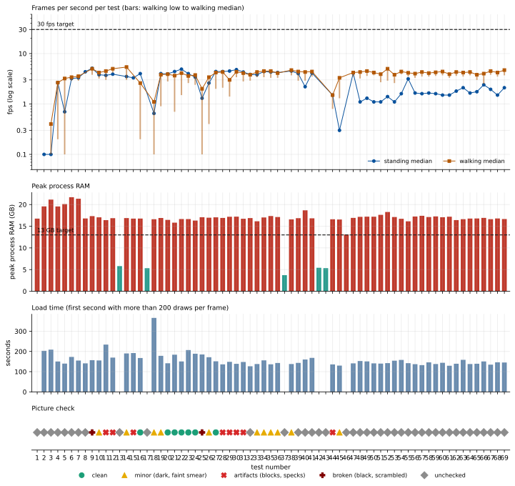
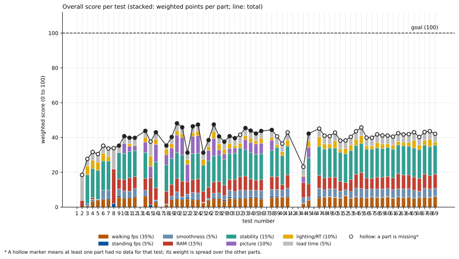

# Test charts

One chart per test run, an overview across all tests and an overall score. Generated from the test log by `test-charts.py`; the numbers for every test are in [tests.csv](tests.csv).

## How the score is computed

Each part is scaled 0 to 100 against the project goal, then combined with these weights. If a part has no data for a test, it is left out and its weight is spread over the other parts (hollow marker on the score chart).

| Part | Weight | 100 points when | 0 points when |
|---|---|---|---|
| Walking fps | 35% | median walking fps is 30 or more | 0 fps |
| Standing fps | 5% | median standing fps is 30 or more | 0 fps |
| Smoothness | 5% | walking low equals walking median | walking low is 0 |
| Peak RAM | 15% | peak process RAM is 13 GB or less | peak is 20 GB or more |
| Stability | 15% | run reached its planned end | crash or black screen (50 for a watchdog or first-run stop) |
| Picture | 10% | clean (minor 60, artifacts or blocks 30) | broken (black or scrambled) |
| Lighting / RT | 10% | ray tracing on (50) plus normal picture brightness (50) | ray tracing off and a near-black or blown-out picture |
| Load time | 5% | first world frame within 60 s | 600 s or more |

Lighting / RT: 50 points if ray tracing was on (read from the run mode; every test so far ran with it off), plus up to 50 for picture brightness: the median mean luminance (0 to 255) of in-world screenshots taken after the load time while drawing more than 200 draws per frame. 50 points when that median is 70 to 140, falling linearly to 0 at 10 or below and at 230 or above. This is only a rough proxy for lighting quality.

## Tests

| Test | Date | Change | Standing fps | Walking fps | Peak RAM (GB) | Load (s) | Picture | Score | Chart |
|---|---|---|---|---|---|---|---|---|---|
| 1 | 2026-11-26 | memory fix 1 | - | - | 16.8 | - | unchecked | - | [chart](test-01.svg) |
| 2 | 2026-11-26 | RAM branch | 0.1 | - | 19.6 | 203 | unchecked | 19* | [chart](test-02.svg) |
| 3 | 2026-11-26 | RAM branch + pressure sweeps | 0.1 | 0.4 | 21.1 | 209 | unchecked | 28* | [chart](test-03.svg) |
| 4 | 2026-11-26 | merged build (all of today's work) | 2.7 | 2.7 | 19.6 | 150 | unchecked | 32* | [chart](test-04.svg) |
| 5 | 2026-11-26 | + skip write-combined copy-back, + window tails | 0.7 | 3.2 | 20.1 | 140 | unchecked | 30* | [chart](test-05.svg) |
| 6 | 2026-11-26 | new build: hair skip, UI mips kept, quiet-copy skip, sliced heap resc... | 3.2 | 3.4 | 21.7 | 173 | unchecked | 35* | [chart](test-06.svg) |
| 7 | 2026-11-26 | + wide refresh | 3.3 | 3.5 | 21.3 | 155 | unchecked | 34* | [chart](test-07.svg) |
| 8 | 2026-11-26 | Series S fix | 4.3 | - | 16.8 | 141 | unchecked | 34* | [chart](test-08.svg) |
| 9 | 2026-11-26 | Series S fix | 5.1 | 5 | 17.3 | 157 | black picture | 35 | [chart](test-09.svg) |
| 10 | 2026-11-26 | Series S picture fix | 3.8 | 4.2 | 17.1 | 155 | shows, very dark | 41 | [chart](test-10.svg) |
| 11 | 2026-11-27 | + ambient light stand-in, title's own upscaler | 3.7 | 4.5 | 16.4 | 234 | white blocks/specks | 40 | [chart](test-11.svg) |
| 12 | 2026-11-27 | same build, repeat | 3.9 | 5 | 16.9 | 170 | white blocks/specks | 40 | [chart](test-12.svg) |
| 13 | 2026-11-27 | DLSS fix, copy changes, fork fixes | - | - | 5.8 | - | not valid | - | [chart](test-13.svg) |
| 14 | 2026-11-27 | fork fixes (shader NaN, helper lanes, cache, compute waits) + DLSS fix | 3.5 | 5.4 | 16.9 | 190 | clean, faint smear | 44 | [chart](test-14.svg) |
| 15 | 2026-11-27 | fork fixes, shader loop limit 1024 (was 32) | 3.3 | - | 16.8 | 192 | white blocks/specks | 38* | [chart](test-15.svg) |
| 16 | 2026-11-27 | fork fixes, title memory kept in place (M1LK_INPLACE=1) | 4 | 2.6 | 16.8 | 167 | clean | 43 | [chart](test-16.svg) |
| 17 | 2026-11-27 | parallel texture checks (M1LK_PARALLEL_REFRESH=1) | - | - | 5.3 | - | unchecked | - | [chart](test-17.svg) |
| 18 | 2026-11-27 | parallel texture checks (M1LK_PARALLEL_REFRESH=1), rerun | 0.7 | 1.1 | 16.6 | 366 | dark, no artifacts named | 35 | [chart](test-18.svg) |
| 19 | 2026-11-27 | fill light 0.6 (M1LK_AMBIENT=0.6; default 0.3) | 4 | 3.8 | 16.9 | 178 | dark, no artifacts named | 40 | [chart](test-19.svg) |
| 20 | 2026-11-27 | fill light follows the sky (M1LK_AMBIENT=sky): picture brightness che... | 4 | 3.9 | 16.5 | 142 | clean | 48 | [chart](test-20.svg) |
| 21 | 2026-11-27 | shader loop cap 1024 instead of 32 (dark picture fix test) | 4.4 | 3.7 | 15.8 | 184 | clean | 46 | [chart](test-21.svg) |
| 22 | 2026-11-27 | in-place constants heap (M1LK_INPLACE_CONSTANTS=1, port constants off) | 4.9 | 4.1 | 16.7 | 151 | clean | 31 | [chart](test-22.svg) |
| 23 | 2026-11-27 | write-watch asked once per step (M1LK_ASK_REASK=1) | 4 | 3.6 | 16.6 | 207 | clean | 46 | [chart](test-23.svg) |
| 24 | 2026-11-27 | in-place constants rerun after the arrange fix | 3.4 | 3.8 | 16.3 | 189 | clean | 47 | [chart](test-24.svg) |
| 25 | 2026-11-27 | GPU detile + in-place constants (fps) | 1.3 | 2 | 17.1 | 185 | scrambled textures | 31 | [chart](test-25.svg) |
| 26 | 2026-11-27 | plugged-in baseline with the submit profiler (the copy profiler was n... | 2.6 | 3.4 | 17 | 171 | clean, faint smear | 39 | [chart](test-26.svg) |
| 27 | 2026-11-27 | batch the per-record indirect clamps (about 2,700 extra GPU passes a... | 4.4 | 4.2 | 17 | 151 | clean | 47 | [chart](test-27.svg) |
| 28 | 2026-11-27 | copy time breakdown (profiling run, no behavior change) | 4.4 | 4.3 | 16.9 | 136 | yard blocks | 41 | [chart](test-28.svg) |
| 29 | 2026-11-27 | in-place host reads instead of a kernel call per copy (ported) | 4.5 | 3 | 17.2 | 149 | yard blocks | 38 | [chart](test-29.svg) |
| 30 | 2026-11-27 | CGBJ low-commit back-off: defer texture uploads and cap look-ahead st... | 4.8 | 4.3 | 17.2 | 139 | yard blocks | 41 | [chart](test-30.svg) |
| 31 | 2026-11-27 | yard-block check: exact wave64 split instead of the per-half approxim... | 4.3 | 4.1 | 16.7 | 148 | yard blocks | 40 | [chart](test-31.svg) |
| 32 | 2026-11-27 | check: start from the cell autosave (pair runs share this start point... | 3.8 | 3.8 | 16.9 | 127 | unchecked | 42* | [chart](test-32.svg) |
| 33 | 2026-11-27 | copy-plain + remap lock ON (its off pair was dropped; round 1 retests... | 3.8 | 4.3 | 16.1 | 138 | clean, faint smear | 45 | [chart](test-33.svg) |
| 34 | 2026-11-27 | round 1 (combo a56b129): baseline A, every switch off | 4.4 | 4.5 | 17 | 156 | floating box, dither | 44 | [chart](test-34.svg) |
| 35 | 2026-11-27 | round 1: ONE change on vs baseline: host copies read title memory in... | 4.3 | 4.5 | 17.4 | 136 | clean, faint smear | 42 | [chart](test-35.svg) |
| 36 | 2026-11-27 | round 1: ONE change on vs baseline: remap lock released right after t... | 4.2 | 4.1 | 17.1 | 143 | dark, no artifacts named | 44 | [chart](test-36.svg) |
| 37 | 2026-11-27 | round 1: ONE change on vs baseline: wider write-watch asks, one scan... | - | - | 3.7 | - | unchecked | - | [chart](test-37.svg) |
| 38 | 2026-11-27 | round 1: ONE change on vs baseline: texture upload back-off under low... | 4.5 | 4.7 | 16.6 | 138 | dark, no artifacts named | 44 | [chart](test-38.svg) |
| 39 | 2026-11-27 | round 1: ONE change on vs baseline: constants heap in place | 4 | 4.4 | 16.9 | 144 | see README | 41* | [chart](test-39.svg) |
| 40 | 2026-11-27 | round 1: ONE change on vs baseline: texture detiling on the card | 2.2 | 4.3 | 18.7 | 160 | see README | 36* | [chart](test-40.svg) |
| 41 | 2026-11-27 | CPU sampling profiler (where the ~215 ms frame goes, per thread and f... | 4.1 | 4.4 | 16.8 | 168 | unchecked | 43* | [chart](test-41.svg) |
| 42 | 2026-11-27 | VIctory-NVIDIA snapshot (test/vnv-base), frame generation off, same s... | - | - | 5.4 | - | unchecked | - | [chart](test-42.svg) |
| 43 | 2026-11-27 | VIctory-NVIDIA snapshot (test/vnv-base) rerun with a log file, frame... | - | - | 5.3 | - | unchecked | - | [chart](test-43.svg) |
| 44 | 2026-11-27 | VIctory-NVIDIA snapshot, now with our save and settings copied into i... | 1.5 | 1.5 | 16.6 | 136 | white blocks/specks | 23* | [chart](test-44.svg) |
| 45 | 2026-11-27 | VIctory-reloaded snapshot 9941051 (its own NVIDIA defaults): whole-bu... | 0.3 | 3.3 | 16.6 | 130 | dark, no artifacts named | 42 | [chart](test-45.svg) |
| 46 | 2026-11-27 | VIctory-reloaded snapshot, second (warm) run: shaders/pipelines alrea... | - | - | 13.1 | - | unchecked | - | [chart](test-46.svg) |
| 47 | 2026-11-27 | round 1 baseline B repeat (current main build, profilers on) | 4.1 | 4.2 | 16.9 | 141 | see README | 45* | [chart](test-47.svg) |
| 48 | 2026-11-27 | pair for r12-homogenize-on (same build, M1LK_INPLACE off) | 1.1 | 4.3 | 17.2 | 153 | unchecked | 41* | [chart](test-48.svg) |
| 49 | 2026-11-27 | M1LK ZCM diagnosis: logs why the constants-heap arrange step exits si... | 1.3 | 4.5 | 17.2 | 151 | unchecked | 41* | [chart](test-49.svg) |
| 50 | 2026-11-27 | ASK_REASK control (same build, switch off): biggest estimated CPU lev... | 1.1 | 4.2 | 17.2 | 141 | unchecked | 43* | [chart](test-50.svg) |
| 51 | 2026-11-27 | ASK_REASK on: stop re-asking GetWriteWatch each flush | 1.1 | 3.9 | 17.6 | 140 | unchecked | 38* | [chart](test-51.svg) |
| 52 | 2026-11-27 | M1LK ZCM fix 650f79b8: the 32-bit graphics heap's reservation recorde... | 1.4 | 5 | 18.3 | 142 | unchecked | 38* | [chart](test-52.svg) |
| 53 | 2026-11-27 | M1LK ZCM combo build (round12 + heap fix 82ffb0bd), both zero-copy sw... | 1.1 | 3.8 | 17.1 | 154 | unchecked | 40* | [chart](test-53.svg) |
| 54 | 2026-11-27 | M1LK ZCM combo build, both zero-copy paths ON: constants heap (174 MB... | 1.6 | 4.4 | 16.7 | 158 | unchecked | 44* | [chart](test-54.svg) |
| 55 | 2026-11-27 | M1LK ZCM Tell (df400589): combo-on plus telling placed textures what... | 3.2 | 4.2 | 16.1 | 142 | unchecked | 46* | [chart](test-55.svg) |
| 56 | 2026-11-27 | M1LK ZCM combo-on without the 2 MB section split: does the section-vi... | 1.6 | 4 | 17.2 | 137 | unchecked | 40* | [chart](test-56.svg) |
| 57 | 2026-11-27 | frame-overlap quick test, existing switches only: combo-on plus more... | 1.6 | 4.3 | 17.4 | 132 | unchecked | 40* | [chart](test-57.svg) |
| 58 | 2026-11-27 | M1LK Watch Skip pair, OFF half (same exe as ws-on | 1.6 | 4.1 | 17.1 | 146 | unchecked | 42* | [chart](test-58.svg) |
| 59 | 2026-11-27 | M1LK Watch Skip ON: skip ~4150 failed write-watch asks/frame on view... | 1.6 | 4.2 | 17.3 | 138 | unchecked | 41* | [chart](test-59.svg) |
| 60 | 2026-11-27 | M1LK Strain: let 4 non-hair programs (cull masks, LOD blends, decal c... | 1.5 | 4.4 | 17.1 | 144 | unchecked | 41* | [chart](test-60.svg) |
| 61 | 2026-11-27 | M1LK Strain OFF half (same exe as strain) | 1.5 | 3.9 | 17.2 | 129 | unchecked | 40* | [chart](test-61.svg) |
| 62 | 2026-11-27 | ladder step 2: Watch Skip (repeat of ws-on, curd exe) | 1.8 | 4.3 | 16.4 | 139 | unchecked | 42* | [chart](test-62.svg) |
| 63 | 2026-11-27 | ladder step 1: none (Watch Skip repeat OFF half, curd exe) | 2.1 | 4.2 | 16.6 | 158 | unchecked | 42* | [chart](test-63.svg) |
| 64 | 2026-11-27 | ladder step 3: Watch Skip + COPY_PLAIN | 1.6 | 4.3 | 16.8 | 138 | unchecked | 42* | [chart](test-64.svg) |
| 65 | 2026-11-27 | ladder step 4: Watch Skip + COPY_PLAIN + M1LK Curd (constant uploads... | 1.8 | 3.8 | 16.8 | 139 | unchecked | 43* | [chart](test-65.svg) |
| 66 | 2026-11-27 | profiling run: submit-path time split into lock waits, card waits, bu... | 2.4 | 4 | 16.9 | 150 | unchecked | 40* | [chart](test-66.svg) |
| 67 | 2026-11-27 | rounds 2+4 in one run: 9 changes (incl. batched write-watch asks) swi... | 1.9 | 4.5 | 16.6 | 135 | unchecked | 43* | [chart](test-67.svg) |
| 68 | 2026-11-27 | round 6: lock-free nothing-new check, all table slots skipped by the... | 1.5 | 4.2 | 16.8 | 146 | unchecked | 44* | [chart](test-68.svg) |
| 69 | 2026-11-27 | M1LK Skimmer ON (held lines on a dedicated thread), A/B 1 | 2.1 | 4.7 | 16.7 | 145 | unchecked | 42* | [chart](test-69.svg) |

\* score computed without every part (see `score_missing_parts` in tests.csv).
